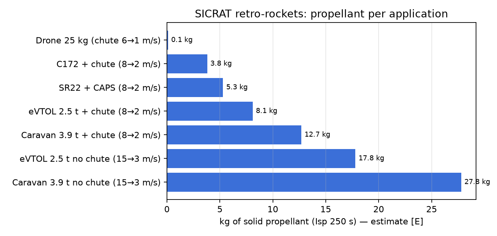
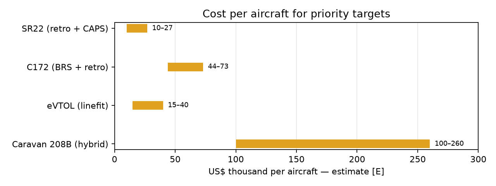

# SICRAT — Integrated Reaction Control and Terminal Cushioning System

**Conceptual design dossier, version 4 (November 2026)**  
**Author and original concept:** Heitor Mouta Almeida (17, student)  
**Support:** Raphael Almeida  
**Contact:** [contact]  
**Public project and simulator:** [link]  
**License:** Open project, CC BY 4.0 — use freely, crediting the source.

> Labels used throughout: **[F]** fact with a cited source; **[E]** authors' estimate, with the calculation shown; **[?]** to be confirmed. Costs are order-of-magnitude ranges. This is a conceptual project at research stage, prepared with AI-assisted tools and reviewed by the authors.

---

## 1. Executive summary

**Problem.** Loss of control in flight (LOC-I) is the leading killer in commercial aviation, causing **41% of fatal accidents and 55% of onboard fatalities** in 2015–2024 (995 of 1,825) [F, IATA]. In light aircraft, spins, loss of control and forced landings over hostile terrain (forest, rivers) remain major risks. In the Amazon, air taxis are often the only means of transport.

**Solution: SICRAT.** Conceived by Heitor Mouta Almeida and inspired by the cold-gas thrusters on the new Tesla Roadster (October 2026), SICRAT combines two subsystems that act in **short pulses** and never try to hold the aircraft up:

1. **Cold-gas (N₂) reaction control** to recover attitude and break spins with yaw and pitch jets. It works without air and is inert, throttleable and refillable.
2. **Solid retro-rockets for terminal cushioning**, which cut the descent rate in the last metres before touchdown. This follows the principle of the Soyuz soft-landing motors.

**Priority targets:** general aviation (Cirrus SR22, Cessna 172), the **Amazon air taxi (Cessna 208B Grand Caravan)**, **eVTOL** and **cargo drones**. Commercial airliners are the long-term research phase.

**Sizing** [E]:

| Application | Mass | Terminal subsystem | Attitude subsystem | System mass |
|---|---|---|---|---|
| SR22 (with CAPS) | 1,633 kg | 5.3 kg propellant (8→2 m/s) | — | 10–20 kg |
| C172 (with BRS parachute) | 1,157 kg | 3.8 kg propellant | — | 45–60 kg (incl. BRS) |
| eVTOL | 2,500 kg | 8 kg (with chute) to 18 kg (without) | light cold gas | 15–40 kg |
| Caravan 208B | 3,900 kg | 13–28 kg propellant | 124 kg N₂ at 300 bar | 220–310 kg |
| Cargo drone | 25 kg | 0.1–0.2 kg | — | < 1 kg |

**Costs** [E]:

- US$ 10–27k per SR22.
- US$ 44–73k per C172, including BRS.
- US$ 100–260k per Caravan.
- US$ 15–40k per eVTOL when factory-installed.
- Certification: US$ 0.5–2M for general aviation and US$ 3–10M for the Caravan.

**Precedents** [F]:

- Soyuz soft-landing motors.
- Cirrus CAPS: 153 saves and 309 survivors, and certified even on the SF50 jet.
- Anti-spin rockets tested by NASA and on the T-28A (1952).
- Cold gas demonstrated on the Tesla Roadster.

---

## 2. Problem and data

| Source | Period | Data |
|---|---|---|
| IATA | 2015–2024 | 66 fatal accidents and 1,825 onboard fatalities. LOC-I accounts for 41% of fatal accidents and 55% of deaths [F] |
| IATA | 2024 | 7 fatal accidents, 1 of them LOC-I (Vinhedo, Brazil, ATR 72, 62 deaths) [F] |
| Boeing StatSum | 2014–2023 | 706 of 1,078 onboard jet fatalities were LOC-I [F] |
| CENIPA | Voepass 2283 | Flat spin for 68 s at about 14,000 ft/min (about 71 m/s) [F] |

---

## 3. SICRAT architecture

### 3.1 Principle: pulse, don't hover

Holding a 60 t aircraft up on thrusters alone would take about 590 kN and about 965 kg/s of gas. SICRAT therefore acts **only in 0.5–4 s pulses** at critical moments. The wings (or the parachute) carry the aircraft the rest of the time [E].

### 3.2 Subsystem A: cold-gas reaction control

- **Jets:** yaw jets at the wingtips or tail for spin exit, and pitch jets in a nose-tail couple for attitude recovery.
- **Gas:** dry nitrogen. It is inert, carries no fire risk and is already part of maintenance infrastructure.
- **Storage:** COPV tanks at 300 bar (302 kg/m³) or 690 bar (495 kg/m³) [E, CoolProp].
- **Valves:** PWM-modulated electromagnetic valves with a response under 10 ms.
- **Load-limited design:** the pitch rate is kept below the rate that would produce 2.5 g (about 7°/s at 120 m/s) [E].

**Caravan 208B sizing** [E]:

- Yaw inertia: I_zz ≈ 38,400 kg·m² (Roskam method).
- Stopping 1 rad/s in 2 s takes 19 kN·m, which is **2.4 kN per wingtip jet** on a 7.9 m arm. Stopping 1.5 rad/s takes 3.6 kN.
- Impulse budget: 3 kN of yaw for 4 s plus 2 kN of pitch for 3 s, with a 2× margin, gives 36 kN·s.
- Gas: at an exhaust velocity of 580 m/s, that is 62 kg of usable N₂. At a 50% usable fraction, **124 kg must be stored**, or 410 L at 300 bar.
- Tanks weigh 50–126 kg.
- The system fits in the ventral cargo pod (494 kg capacity [?]).

**Precedent** [F]: in 1952, 363 kgf JATO bottles on the wingtips of a T-28A stopped spins even with adverse controls. NASA H₂O₂ rockets recovered unrecoverable spins on a light aircraft in under one turn.

### 3.3 Subsystem B: terminal cushioning retro-rockets

Formulas [E]:

- a = (v₁² − v₂²)/(2h)
- F = m·(a + g)
- t = (v₁ − v₂)/a
- I = F·t
- mₚ = I/(Isp·g₀), with Isp = 250 s

| Case | Decel. | Thrust | Burn | Impulse | Propellant |
|---|---|---|---|---|---|
| C172 under parachute, 8→2 m/s in 1 m | 3.1 g | 46 kN | 0.20 s | 9.2 kN·s | 3.8 kg |
| SR22 under CAPS, 8→2 m/s in 1 m | 3.1 g | 65 kN | 0.20 s | 13 kN·s | 5.3 kg |
| eVTOL 2.5 t with parachute, 8→2 m/s in 1 m | 3.1 g | 100 kN | 0.20 s | 20 kN·s | 8.1 kg |
| eVTOL 2.5 t without parachute, 15→3 m/s in 5 m | 2.2 g | 79 kN | 0.56 s | 44 kN·s | 17.8 kg |
| Caravan under parachute, 8→2 m/s in 1 m | 3.1 g | 155 kN | 0.20 s | 31 kN·s | 12.7 kg |
| Caravan without parachute, 15→3 m/s in 5 m | 2.2 g | 123 kN | 0.56 s | 68 kN·s | 27.8 kg |

The 2–3 g deceleration is well within seat test levels of 14–16 g (14 CFR 25.562 / 23.562) [F]. Firing logic follows the Soyuz Kaktus gamma-ray altimeter, which warns at 15 m and fires at 0.8 m [F]. In SICRAT the ignition height is computed live: h_ign = v_z²/(2·a_net), with a_net = (F + L)/m − g.

### 3.4 Avionics and 3-phase logic

- **Hardware:** a triple-modular-redundant (TMR) computer, a dedicated 28 V LiFePO4 battery, triple IMUs, and dual radar altimeters and lidars.
- **Phase 1, envelope guard:** triggers on an upset (more than 25° nose-up, more than 10° nose-down or more than 45° bank, per AC 120-111 [F]) when the controls don't respond. Requires 2-of-3 sensor voting or a guarded manual switch.
- **Phase 2, conservation:** valves stay closed during the glide, so gas and propellant are saved for the final contact.
- **Phase 3, terminal ignition:** firing is computed live, armed only at low height and with a manual inhibit.

### 3.5 Operating environment

- **Thin air:** air density is 74% of sea level at 3 km and 25% at 12 km [F, ISA]. The jets don't need air, and their thrust even rises with altitude.
- **Cold:** at −56.5 °C, solid propellant is typically qualified for −54 to +71 °C [?], and the tanks sit in a heated area.

### 3.6 Operating limits: finite resources [E]

SICRAT is **not a long-duration system**. The cold gas gives **a few seconds of total jet time**, and each retro-rocket fires **once, for a fraction of a second**. The table summarises what each aircraft has available (calc5.py):

| Aircraft | N₂ impulse | Total jet time ≈ 0.5 s pulses | Stop 1 rad/s / no. of stops | Min. height for spin recovery | Retro burn (single shot) | Retro trigger height |
|---|---|---|---|---|---|---|
| Cargo drone 25 kg | 0.1 kN·s (optional) | 4.0 s ≈ 8 | 0.25 s / ~16.0 | ~37 m (~120 ft) | 0.46 s | ~3 m |
| Cessna 172 | 5.8 kN·s (optional) | 11.6 s ≈ 23 | 1.49 s / ~7.8 | ~204 m (~670 ft) | 0.20 s | ~1 m |
| Cirrus SR22 | 8.0 kN·s (optional) | 11.4 s ≈ 22 | 1.59 s / ~7.2 | ~229 m (~750 ft) | 0.20 s | ~1 m |
| eVTOL 2.5 t | 8.0 kN·s (optional) | 8.0 s ≈ 16 | 1.67 s / ~4.8 | ~164 m (~540 ft) | 0.20 s | ~1 m |
| Cessna 208B Caravan | 36.0 kN·s | 12.0 s ≈ 24 | 1.62 s / ~7.4 | ~320 m (~1050 ft) | 0.20 s | ~1 m |

- **Minimum height for spin recovery:** 1 s reaction time, plus the time to stop the rotation, plus a pull-out limited to 2.5 g, with a 1.5× margin. Below it, the parachute plus retro-rocket is the fallback.
- **Retro-rocket:** the sensor (lidar/radar altimeter) tracks the descent from about 15 m and fires at the height shown. There is no second chance: if it fails, touchdown happens at parachute speed (about 8 m/s).
- **Empty tank:** if the N₂ runs out before the rotation stops, the outcome is the same as having no system. That is why the 3-phase logic saves gas and tank pressure is checked before every flight.
- The simulator (`sim/index.html`) shows the tanks depleting and what happens when the resource runs out.

### 3.7 Scenario: control surface jammed by ice [E]

Example: on the Caravan, an aileron jams with ice and produces a constant rolling moment (≈ 3.5 kN·m, assumed for illustration).

- **Without help:** with I_xx ≈ 15,122 kg·m², the aircraft would pass 60° of bank within seconds (≈ 3 s without aerodynamic damping).
- **With SICRAT:** the wingtip nozzles (firing up/down) apply a counter-moment. About 443 N per nozzle is enough (7.9 m arm) while the pilot adjusts rudder, power, speed and approach over about 15 s. This uses ≈ 3.3 kN·s (9% of the tank); with a full tank, the moment could be held for ~81 s at most.
- **What SICRAT does not do:** it **does not de-ice** and **does not restore lift**. Ice can cut CLmax by about 30% and raise drag by about 40% [F/?, FAA], which raises stall speed by about 20% [E]. The system **only buys seconds** for the pilot to leave the icing condition and land.

---

## 4. Safety and certification

**Regulatory path:**

- Part 23 / RBAC 23 with a **Supplemental Type Certificate (STC)** for retrofits.
- A **Special Condition** (14 CFR 21.16) for the novel technology, as was done for the Cirrus SF50 CAPS (23-275-SC) [F].

**Critical failure: inadvertent firing.**

- Mitigations: 2-of-3 voting, arming by height and sink rate, a manual inhibit, dual initiators and asymmetry detection.
- Lesson: on Credible Sport (C-130, 1980), early manual firing of the braking rockets caused a hard landing [F]. SICRAT's logic is therefore automatic and redundant.

**Cold gas:**

- Pressure relief: TPRDs and burst discs vented overboard.
- Protection and monitoring: an aramid blanket and pressure telemetry.
- Maintenance: a hydrostatic test every 5 years.
- Asphyxiation risk: O₂ sensors in the compartments.
- Nozzles: hinged covers.

**Pyrotechnics:**

- UN class 1.4 logistics.
- Replacement about every 10 years, as with the CAPS rocket.
- Marking for rescue crews.

---

## 5. Costs and business case

### 5.1 Market references [F]

| Reference | Value |
|---|---|
| BRS for a Cessna 172, installed | US$ 34,400, 40–60 h of labour, +79 lb (Goodrich / AOPA) |
| CAPS repack (parachute plus rocket, every 10 years) | US$ 18,500–22,000 (Avias / All In) |
| Certification | Large STC about US$ 250M; new Part 25 TC about US$ 1B (MITRE for the FAA, 2022) |

### 5.2 Costs per priority application [E]

Assumptions: labour at US$ 120–180/h, fuel at US$ 0.65–0.90/kg, and a weight penalty of 2.5–4% of the added mass per flight hour.

| Application | Per aircraft | Certification | Downtime | Fuel per year | Maintenance per year |
|---|---|---|---|---|---|
| SR22 (retro plus existing CAPS) | US$ 10–27k | US$ 0.5–2M | 3–7 days | < US$ 100 | US$ 300–900 |
| C172 (BRS plus retro) | US$ 44–73k | US$ 0.5–2M | 5–10 days | US$ 100–400 | US$ 800–1,500 |
| eVTOL (factory-installed) | US$ 15–40k | within the eVTOL TC | — | — | [?] |
| Caravan 208B (hybrid) | US$ 100–260k | US$ 3–10M | 5–10 days | US$ 2–13k | US$ 2–6k |

### 5.3 Commercial value

- **Cirrus:** the SR22 has been the world's best-selling GA aircraft every year since 2002–2003, with CAPS at the heart of the brand [F]. SICRAT adds a soft final touchdown to the parachute, which today lands at about 9 m/s.
- **Amazon air taxi:** a clear selling point for operators and passengers on routes over forest and river, delivered as an add-on module in the cargo pod.
- **eVTOL:** these aircraft fly low over cities with limited glide. A parachute plus retro-rockets is a strong argument both for certification and for public acceptance.
- **Long-term market:** 27,150 commercial aircraft in 2024 and 43,600 deliveries forecast to 2044 (Boeing CMO 2025) [F].

---

## 6. Long-term phase: commercial aviation

The general-aviation and Caravan programme builds the reliability, sensor and logic data needed for a later phase. That phase would study SICRAT as a **last-resort actuator integrated with fly-by-wire** on regional jets and narrowbodies, for low-dynamic-pressure upsets such as deep stall and spin, and for loss of controls.

Orders of magnitude for that phase [E]:

- System mass of 0.8–1.5 t.
- Development cost of US$ 0.3–1B per aircraft family.
- Unit cost of US$ 0.5–1.5M at scale.

---

## 7. Roadmap and partnership

| Phase | Timing | Deliverable |
|---|---|---|
| 1. Simulation and bench demonstrator | 0–6 months | Open 1D/6DOF simulator; 1 kg capsule braked by compressed-air jets |
| 2. 5–25 kg drone (with a partner lab) | 6–18 months | Parachute plus retro drop tests; 3-phase logic running in hardware |
| 3. Light aircraft (SR22/C172) | 2–4 years | Retro module integrated with BRS/CAPS; drop tests; STC path |
| 4. Caravan / eVTOL | 3–6 years | Anti-spin cold gas in wind tunnel and simulator; installed prototype |
| 5. Commercial (research) | 6+ years | Studies with a manufacturer |

**Contributions sought** (the project is open; anyone can contribute):

- **Embraer / Embraer-X:** eVTOL (Eve), autonomous flight and regional aviation.
- **Univap:** Aeronautical and Space Engineering, with wind tunnel, flight simulator and model-aircraft field.
- **Universities (Mauá, FEI, ITA):** test rigs, wind tunnels, cold chambers and student research.

SICRAT is an **open project**: data, calculations and drawings are public so that any team can build and improve the solutions.

---

## 8. Authorship

**Original SICRAT concept:** Heitor Mouta Almeida (17, student).  
**Support, review and organisation:** Raphael Almeida.  
Contact: [contact]

**License:** Open project, CC BY 4.0 — use freely, crediting the source. Text and drawings under CC BY 4.0 (https://creativecommons.org/licenses/by/4.0/); code under the MIT license. The goal is to save lives and improve aviation: anyone, any university or company may use, adapt and improve SICRAT.

---

## 9. References

1. IATA safety recommendations 2024. https://www.iata.org/contentassets/95e933e1ad794068812f073cf883cb08/recommendations-for-accident-prevention-2024_final.pdf
2. Boeing Statistical Summary. https://www.boeing.com/content/dam/boeing/v2/company/statsum.pdf
3. Boeing CMO 2025–2044. https://www.boeing.com/content/dam/boeing/boeingdotcom/market/assets/downloads/2025-commercial-market-outlook.pdf
4. CENIPA PS-VPB final report. https://sistema.cenipa.fab.mil.br/cenipa/paginas/relatorios/rf/en/RF_PS-VPB_09_08_2024_Eng.PUB..pdf
5. Soyuz landing. https://www.russianspaceweb.com/soyuz-landing.html
6. COPA CAPS Event History. https://www.cirruspilots.org/Safety/CAPS-Event-History
7. FAA Special Conditions, SF50 CAPS. https://www.federalregister.gov/documents/2016/07/15/2016-16813/special-conditions-cirrus-design-corporation-model-sf50-whole-airplane-parachute-recovery-system
8. NASA, Rockets for Spin Recovery. https://ntrs.nasa.gov/api/citations/19800020866/downloads/19800020866.pdf ; NASA H₂O₂ rockets: https://ntrs.nasa.gov/citations/19790063866
9. Operation Credible Sport. https://en.wikipedia.org/wiki/Operation_Credible_Sport
10. 14 CFR Part 25. https://www.ecfr.gov/current/title-14/chapter-I/subchapter-C/part-25
11. BRS pricing. https://goodrichaviation.com/brs-parachutes ; AOPA: https://www.aopa.org/news-and-media/all-news/2017/october/04/brs-announces-cessna-parachute-installation-network
12. CAPS repack pricing. https://aviasfly.com/caps/
13. MITRE for the FAA, certification costs. https://airgways.com/wp-content/uploads/2022/06/aw-mitre-report-for-faa-march-2022.pdf
14. Aviation Week, SR22. https://aviationweek.com/business-aviation/aircraft-propulsion/20twenty-cirrus-sr22-perennial-piston-best-seller
15. Tesla Roadster cold gas. https://www.space.com/technology/spacex-thrusters-just-made-a-tesla-roadster-fly-and-elon-musks-car-is-still-out-there-in-space
16. Mauá research topics (IMT-Boeing lab). https://maua.br/img/upload/mechanical-engineering-research-topics-and-projetcs-1712934480.pdf
17. CoolProp. http://www.coolprop.org/
