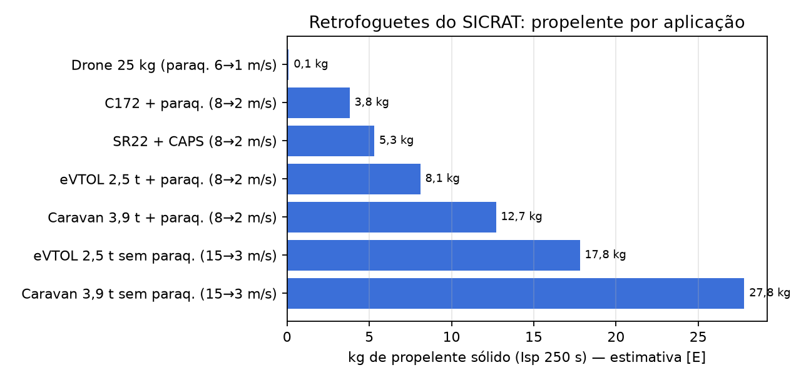
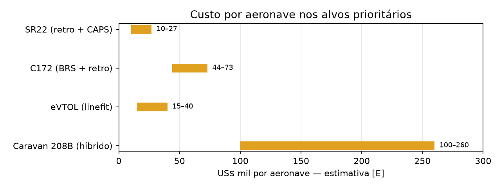

# SICRAT — Sistema Integrado de Controle de Reação e Amortecimento Terminal

**Dossiê de projeto conceitual, versão 4 (novembro de 2026)**  
**Autor e idealizador:** Heitor Mouta Almeida (17 anos, estudante)  
**Apoio:** Raphael Almeida  
**Contato:** [contato]  
**Projeto público:** https://github.com/phalmeida-dot/sicrat  
**Simulador:** https://phalmeida-dot.github.io/sicrat/sim/  
**Licença:** Projeto aberto, CC BY 4.0 — use livremente, citando a origem.

> Convenção usada em todo o documento: **[F]** fato com fonte citada; **[E]** estimativa dos autores, com a conta mostrada; **[?]** dado a confirmar. Custos são faixas de ordem de grandeza. Este é um projeto conceitual em fase de pesquisa. Elaborado com apoio de ferramentas de IA e revisado pelos autores.

---

## 1. Sumário executivo

**Problema.** A perda de controle em voo (LOC-I) é a principal causa de mortes na aviação comercial: **41% dos acidentes fatais e 55% das mortes a bordo** entre 2015 e 2024 (995 de 1.825) [F, IATA]. Nas aeronaves leves, parafusos, perda de controle e pousos forçados sobre terreno hostil (floresta, rio) seguem sendo grandes riscos. Na Amazônia, o táxi aéreo é muitas vezes o único transporte disponível.

**Solução: SICRAT.** Concebido por Heitor Mouta Almeida e inspirado nos propulsores de gás frio do novo Tesla Roadster (outubro de 2026), o SICRAT combina dois subsistemas que atuam em **pulsos curtos**, sem tentar sustentar a aeronave:

1. **Controle de reação a gás frio (N₂):** recupera atitude e tira a aeronave de parafuso com jatos de guinada e arfagem. Funciona independentemente do ar e é inerte, modulável e recarregável.
2. **Retrofoguetes sólidos de amortecimento terminal:** reduzem a velocidade de descida nos últimos metros antes do toque, no princípio dos motores de pouso suave da Soyuz.

**Alvos prioritários:** aviação geral (Cirrus SR22, Cessna 172), **táxi aéreo amazônico (Cessna 208B Grand Caravan)**, **eVTOL** e **drones de carga**. A aviação comercial é a fase de pesquisa de longo prazo.

**Dimensionamento** [E]:

| Aplicação | Massa | Subsistema terminal | Subsistema de atitude | Massa do sistema |
|---|---|---|---|---|
| SR22 (com CAPS) | 1.633 kg | 5,3 kg de propelente (8→2 m/s) | — | 10–20 kg |
| C172 (com paraquedas BRS) | 1.157 kg | 3,8 kg de propelente | — | 45–60 kg (inclui BRS) |
| eVTOL | 2.500 kg | 8 kg (com paraquedas) a 18 kg (sem) | gás frio leve | 15–40 kg |
| Caravan 208B | 3.900 kg | 13–28 kg de propelente | 124 kg de N₂ a 300 bar | 220–310 kg |
| Drone de carga | 25 kg | 0,1–0,2 kg | — | < 1 kg |

**Custos** [E]: US$ 10–27 mil por SR22, US$ 44–73 mil por C172 (já com BRS), US$ 100–260 mil por Caravan e US$ 15–40 mil por eVTOL instalado de fábrica. Certificação: US$ 0,5–2 mi na aviação geral e US$ 3–10 mi no Caravan.

**Precedentes que mostram que o caminho existe** [F]:

- Motores de pouso suave da Soyuz.
- Cirrus CAPS: 153 salvamentos e 309 sobreviventes; certificado inclusive no jato SF50.
- Foguetes antiparafuso testados pela NASA e no T-28A em 1952.
- Gás frio demonstrado no Tesla Roadster.

---

## 2. Problema e dados

| Fonte | Período | Dado |
|---|---|---|
| IATA | 2015–2024 | 66 acidentes fatais, 1.825 mortes a bordo; LOC-I = 41% dos acidentes fatais e 55% das mortes [F] |
| IATA | 2024 | 7 acidentes fatais; 1 LOC-I (Vinhedo/SP, ATR 72, 62 mortes) [F] |
| Boeing StatSum | 2014–2023 | 706 de 1.078 mortes a bordo em jatos foram LOC-I [F] |
| CENIPA | Voepass 2283 | Parafuso chato por 68 s a ~14.000 ft/min (~71 m/s) [F] |

O caso Vinhedo mostra o cenário-alvo do subsistema de atitude: um **parafuso** do qual os comandos aerodinâmicos não conseguiram tirar a aeronave.

---

## 3. Arquitetura do SICRAT

### 3.1 Princípio: pulsar, não pairar

Manter no ar uma aeronave de 60 t só com propulsores exigiria cerca de 590 kN e cerca de 965 kg/s de gás. Por isso o SICRAT atua **apenas em pulsos de 0,5 a 4 s**, nos momentos críticos, enquanto as asas (ou o paraquedas) continuam sustentando a aeronave [E].

### 3.2 Subsistema A: controle de reação a gás frio

- **Bocais de guinada** nas pontas de asa ou na cauda, para sair de parafusos, e **bocais de arfagem** em binário nariz-cauda, para recuperar atitude.
- **Gás:** nitrogênio seco, inerte e sem risco de fogo, já disponível na infraestrutura de manutenção.
- **Armazenamento:** tanques COPV a 300 bar (N₂ a 302 kg/m³) ou 690 bar (495 kg/m³) [E, CoolProp].
- **Controle:** válvulas eletromagnéticas com modulação PWM e resposta abaixo de 10 ms.
- **Projeto pelo limite de carga:** a taxa de arfagem fica abaixo da que produz 2,5 g, ou seja, cerca de 7°/s a 120 m/s. O sistema recupera a aeronave em segundos e sem sobrecarregar a estrutura [E, 14 CFR 25.337 / Part 23].

**Dimensionamento no Caravan 208B** [E]:

- Inércia de guinada: I_zz ≈ 38.400 kg·m² (método de Roskam).
- Parar uma rotação de 1 rad/s em 2 s exige um momento de 19 kN·m, ou **2,4 kN por bocal** nas pontas de asa (braço de 7,9 m). Para 1,5 rad/s, 3,6 kN.
- **Orçamento de impulso:** guinada de 3 kN por 4 s mais arfagem de 2 kN por 3 s, com margem de 2×, dá 36 kN·s.
- **Gás:** com velocidade de exaustão de 580 m/s (gás resfriado na descarga), são 62 kg de N₂ utilizável. Considerando que 50% do armazenado é aproveitável, são **124 kg armazenados**, ou 410 L a 300 bar.
- **Tanques:** de 50 a 126 kg, conforme a tecnologia de COPV (PV/W de 25 a 10 km).
- **Instalação:** no cargo pod ventral (capacidade de 494 kg [?]), preservando os assentos.

**Precedente** [F]: em 1952, garrafas JATO de 363 kgf nas pontas de asa de um T-28A interromperam parafusos mesmo com os comandos contrários. A NASA usou foguetes de H₂O₂ num avião leve e recuperou parafusos irrecuperáveis em menos de 1 volta.

### 3.3 Subsistema B: retrofoguetes de amortecimento terminal

Fórmulas: a = (v₁² − v₂²)/(2h); F = m·(a + g); t = (v₁ − v₂)/a; I = F·t; mₚ = I/(Isp·g₀), com Isp = 250 s para propelente composto [E].

| Caso | Desacel. | Empuxo | Queima | Impulso | Propelente |
|---|---|---|---|---|---|
| C172 sob paraquedas, 8→2 m/s em 1 m | 3,1 g | 46 kN | 0,20 s | 9,2 kN·s | 3,8 kg |
| SR22 sob CAPS, 8→2 m/s em 1 m | 3,1 g | 65 kN | 0,20 s | 13 kN·s | 5,3 kg |
| eVTOL 2,5 t com paraquedas, 8→2 m/s em 1 m | 3,1 g | 100 kN | 0,20 s | 20 kN·s | 8,1 kg |
| eVTOL 2,5 t sem paraquedas, 15→3 m/s em 5 m | 2,2 g | 79 kN | 0,56 s | 44 kN·s | 17,8 kg |
| Caravan sob paraquedas, 8→2 m/s em 1 m | 3,1 g | 155 kN | 0,20 s | 31 kN·s | 12,7 kg |
| Caravan sem paraquedas, 15→3 m/s em 5 m | 2,2 g | 123 kN | 0,56 s | 68 kN·s | 27,8 kg |

- **Ocupantes:** a desaceleração fica entre 2 e 3 g, muito abaixo dos limites de ensaio de assentos (14–16 g, 14 CFR 25.562 / 23.562) [F].
- **Disparo:** a lógica é a da Soyuz (altímetro de raios gama Kaktus: aviso a 15 m e disparo a 0,8 m) [F]. No SICRAT, a altura de disparo é calculada em tempo real: h_ign = v_z² / (2·a_líq), com a_líq = (F + L)/m − g.

### 3.4 Aviônica e lógica (máquina de 3 fases)

- **Hardware:** computador TMR (redundância modular tripla), bateria LiFePO4 de 28 V própria, IMU tripla, radioaltímetro e lidar duplos.
- **Fase 1, guarda de envelope:** acionamento ao detectar "upset" (mais de 25° nariz acima, mais de 10° abaixo ou mais de 45° de inclinação, AC 120-111 [F]) sem resposta dos comandos, com votação 2 de 3 dos sensores ou acionamento manual protegido.
- **Fase 2, conservação:** válvulas fechadas no planeio, reservando gás e propelente para o contato final.
- **Fase 3, ignição terminal:** disparo calculado, armado só em baixa altura e com inibição manual.

### 3.5 Ambiente de operação

- **Ar rarefeito:** a densidade é 74% da do nível do mar a 3 km e 25% a 12 km [F, ISA]. Os jatos não dependem do ar, e o empuxo até aumenta com a altitude.
- **Temperatura:** a −56,5 °C, o propelente sólido é qualificado tipicamente de −54 a +71 °C [?], e os tanques ficam em área aquecida. Na descarga rápida o N₂ esfria, o que já está considerado na velocidade de exaustão de 580 m/s.

### 3.6 Limites de uso: recursos finitos [E]

O SICRAT **não é um sistema de longa duração**. O gás frio dá **alguns segundos de jato no total**, e cada retrofoguete queima **uma única vez, por frações de segundo**. A tabela resume o que cada aeronave tem disponível (calc5.py):

| Aeronave | Impulso de N₂ | Tempo total de jato ≈ pulsos de 0,5 s | Parar 1 rad/s / nº de paradas | Altura mín. para sair de parafuso | Queima do retro (única) | Altura de disparo do retro |
|---|---|---|---|---|---|---|
| Drone de carga 25 kg | 0,1 kN·s (opcional) | 4,0 s ≈ 8 | 0,25 s / ~16,0 | ~37 m (~120 ft) | 0,46 s | ~3 m |
| Cessna 172 | 5,8 kN·s (opcional) | 11,6 s ≈ 23 | 1,49 s / ~7,8 | ~204 m (~670 ft) | 0,20 s | ~1 m |
| Cirrus SR22 | 8,0 kN·s (opcional) | 11,4 s ≈ 22 | 1,59 s / ~7,2 | ~229 m (~750 ft) | 0,20 s | ~1 m |
| eVTOL 2,5 t | 8,0 kN·s (opcional) | 8,0 s ≈ 16 | 1,67 s / ~4,8 | ~164 m (~540 ft) | 0,20 s | ~1 m |
| Cessna 208B Caravan | 36,0 kN·s | 12,0 s ≈ 24 | 1,62 s / ~7,4 | ~320 m (~1050 ft) | 0,20 s | ~1 m |

- **Altura mínima para sair de parafuso:** 1 s de reação + tempo para parar a rotação + arremetida limitada a 2,5 g, com margem de 1,5×. Abaixo dela, o recurso é o paraquedas com retrofoguete.
- **Retrofoguete:** o sensor (lidar/radioaltímetro) acompanha a descida desde cerca de 15 m e dispara na altura indicada. Não há segunda chance: se falhar, o toque acontece na velocidade do paraquedas (cerca de 8 m/s).
- **Tanque vazio:** se o N₂ acabar antes de a rotação parar, o resultado é o mesmo de não ter o sistema. Por isso a lógica de 3 fases economiza gás e o tanque é monitorado (pressão) antes de cada voo.
- O simulador (`sim/index.html`) mostra os tanques esvaziando e o que acontece quando o recurso acaba.

### 3.7 Cenário: superfície de comando travada por gelo [E]

Exemplo: no Caravan, um aileron trava por gelo e passa a produzir um momento de rolagem constante (≈ 3.5 kN·m, adotado para ilustração).

- **Sem ajuda:** com I_xx ≈ 15.122 kg·m², a aeronave passaria de 60° de inclinação em poucos segundos (≈ 3 s sem amortecimento aerodinâmico).
- **Com o SICRAT:** os bocais das pontas de asa (para cima/para baixo) aplicam um momento contrário. Bastam cerca de 443 N por bocal (braço de 7,9 m), enquanto o piloto ajusta leme, potência, velocidade e aproximação em cerca de 15 s. Isso consome ≈ 3.3 kN·s (9% do tanque); com o tanque cheio, o momento poderia ser segurado por ~81 s no máximo.
- **O que o SICRAT não faz:** ele **não remove o gelo** e **não devolve a sustentação**. O gelo pode reduzir o CLmax em cerca de 30% e aumentar o arrasto em cerca de 40% [F/?, FAA], o que eleva a velocidade de estol em cerca de 20% [E]. O sistema **só ganha segundos** para o piloto sair da condição de gelo e pousar.

---

## 4. Segurança e certificação

- **Caminho regulatório:** Part 23 / RBAC 23 com **STC** para retrofit, e **Special Condition** (14 CFR 21.16) para tecnologia nova, como aconteceu com o CAPS do Cirrus SF50 (23-275-SC) [F].
- **Falha crítica: disparo indevido.** Mitigações: votação 2 de 3, arme por altura e razão de descida, inibição manual, iniciadores duplos e detecção de assimetria. Lição histórica: no Credible Sport (C-130, 1980), o disparo manual precoce dos foguetes de frenagem causou um pouso duro [F]. Por isso a lógica é automática e redundante.
- **Gás frio:** TPRD e discos de ruptura com exaustão externa, manta de aramida, telemetria de pressão, ensaio hidrostático a cada 5 anos, sensor de O₂ nos compartimentos (risco de asfixia) e bocais com tampas articuladas.
- **Pirotecnia:** logística de explosivos classe 1.4 da ONU, troca a cada cerca de 10 anos (como o foguete do CAPS) e sinalização para equipes de resgate.

---

## 5. Custos e caso de negócio

### 5.1 Referências de mercado [F]

| Referência | Valor |
|---|---|
| BRS para Cessna 172, instalado | US$ 34.400; 40–60 h; +79 lb (Goodrich / AOPA) |
| Reempacotamento do CAPS (paraquedas + foguete, a cada 10 anos) | US$ 18.500–22.000 (Avias / All In) |
| Certificação | STC de grande porte ≈ US$ 250 mi; TC novo de Part 25 ≈ US$ 1 bi (MITRE para a FAA, 2022) |

### 5.2 Custos por aplicação prioritária [E]

Premissas: mão de obra de US$ 120–180/h, combustível de US$ 0,65–0,90/kg, penalidade de peso de 2,5–4% da massa extra por hora de voo.

| Aplicação | Custo por aeronave | Certificação | Parada | Combustível/ano | Manutenção/ano |
|---|---|---|---|---|---|
| SR22 (retro + CAPS existente) | US$ 10–27 mil | US$ 0,5–2 mi | 3–7 dias | < US$ 100 | US$ 300–900 |
| C172 (BRS + retro) | US$ 44–73 mil | US$ 0,5–2 mi | 5–10 dias | US$ 100–400 | US$ 800–1.500 |
| eVTOL (de fábrica) | US$ 15–40 mil | integrado ao TC do eVTOL | — | — | [?] |
| Caravan 208B (híbrido) | US$ 100–260 mil | US$ 3–10 mi | 5–10 dias | US$ 2–13 mil | US$ 2–6 mil |

### 5.3 Valor comercial

- **Cirrus:** o SR22 é o avião de aviação geral mais vendido do mundo todos os anos desde 2002–2003, com o CAPS no centro da marca [F, Aviation Week]. O SICRAT acrescenta ao paraquedas o pouso suave final, que hoje acontece a cerca de 9 m/s.
- **Táxi aéreo amazônico:** um diferencial claro para operadores e passageiros em rotas sobre floresta e rio, com um módulo instalável no cargo pod.
- **eVTOL:** as aeronaves de mobilidade aérea urbana voam baixo sobre cidades e têm planeio limitado. Um sistema de paraquedas com retrofoguetes é um argumento forte de certificação e de aceitação pública.
- **Mercado de referência:** 27.150 aviões comerciais em 2024 e 43.600 entregas previstas até 2044 (Boeing CMO 2025) [F], na fase de longo prazo.
- **Riscos a gerenciar:** percepção do público (comunicar o sistema como "airbag da aviação"), responsabilidade por disparo indevido e prazo regulatório.

---

## 6. Fase de longo prazo: aviação comercial

A pesquisa na aviação geral e no Caravan gera os dados de confiabilidade, sensores e lógica que permitem estudar, numa fase posterior, o SICRAT como **atuador de último recurso integrado ao fly-by-wire** de jatos regionais e narrowbodies. Isso cobre situações de baixa pressão dinâmica, como estol profundo e parafuso, e perda de comandos. Ordens de grandeza para essa fase [E]: sistema de 0,8–1,5 t, desenvolvimento de US$ 0,3–1 bi por família e custo unitário de US$ 0,5–1,5 mi em escala.

---

## 7. Estado da arte e originalidade

Levantamento feito em 21 nov. 2026 no Google Patents, no FreePatentsOnline (espelho de patentes alemãs e europeias), no servidor técnico da NASA (NTRS) e em fontes jornalísticas e institucionais. As citações seguem a ABNT NBR 10520:2023 (sistema autor-data) e as referências completas estão na seção 11, conforme a ABNT NBR 6023:2018.

### 7.1 O que já existe

| Tema | Anterioridade | O que faz | Como o SICRAT se diferencia |
|---|---|---|---|
| Paraquedas de aeronave inteira | Popov (1986); Cirrus CAPS (COPA, 2026; Estados Unidos, 2016) | Foguete ou carga extrai um paraquedas que desce a aeronave inteira. | O SICRAT **usa** esse paraquedas como etapa e acrescenta controle de atitude e amortecimento final. |
| Paraquedas com foguete de tração forte | Popov e Popov (2023) | Foguete de dois estágios; o 2º estágio pode ter empuxo maior que o peso da aeronave para frear a queda livre, puxando pelo paraquedas. | No SICRAT o freio final é um retrofoguete na própria aeronave, acionado perto do solo. |
| Paraquedas + retrofoguete no toque | Soyuz (Zak, [20--]); sistema PRSM-915 "Reaktavr", 1976 (Vasily…, 2026; Armor…, [20--]) | Paraquedas único e motores de pouso suave acionados por sondas perto do solo. | **O princípio não é novo.** O SICRAT o aplica a aviões leves que já têm paraquedas certificado (CAPS/BRS), com dimensionamento de 8→2 m/s. |
| Foguetes que freiam a aeronave perto do solo | Allen (1987) | Foguetes voltados para baixo no helicóptero, disparados por sensor de proximidade. | O SICRAT associa o freio a um paraquedas e a um subsistema separado de atitude. |
| Paraquedas + foguetes para manter a atitude | Schubert (2000) | Paraquedas principal e de frenagem; foguetes de direção mantêm a fuselagem nivelada e evitam rolamento na descida. | Anterioridade próxima da ideia de "corrigir a atitude com jatos durante a descida". O SICRAT usa gás frio pulsado e recarregável, também **antes** do paraquedas (parafuso). |
| Foguetes para reorientar **e** frear + paraquedas | Groden e Adler (2018; 2021), SkyRyse | Subsistema balístico com foguetes (inclusive retrofoguetes) para reorientar e/ou desacelerar o veículo antes do impacto, com paraquedas. Foco em helicópteros. | **É a anterioridade mais próxima.** O SICRAT separa as funções: gás frio N₂ (inerte, muitos pulsos) para atitude e retro sólido de queima única para o toque, com foco em asa fixa e táxi aéreo. |
| Foguetes antiparafuso | O'Bryan, Glover e Edwards (1979); Whipple (1980); Lucy (1985) | Foguetes de H₂O₂ ou sólidos na ponta da asa, testados pela NASA para tirar aviões leves de parafuso. | O SICRAT troca foguetes de uso único por pulsos de gás frio recarregável e soma o amortecimento final. |
| Controle de reação em aeronaves | X-15: Jarvis e Lock (1965); Harrier/Kestrel (Smithsonian Institution, [20--]) | Jatos de H₂O₂ (X-15) e de ar sangrado do motor (Harrier) controlam a atitude onde as superfícies não funcionam. | O SICRAT usa tanque de N₂ independente do motor, como reserva de emergência por poucos segundos. |
| Gás frio em veículo | Tesla Roadster (Wall, 2026) | Propulsores de gás frio em um carro. | Inspiração direta do Heitor; o SICRAT leva o conceito para a segurança de voo. |
| Cabine destacável | Giannakopoulos (2003); Tatarenko, 2016 (Atkin, 2016; Morvan, [2016]); Xia, Liao e Zhou (2022); Sandrapaty (2024); Laudrain (2015), Airbus, só para embarque | Separar a cabine e descê-la de paraquedas. | O SICRAT **não** separa a cabine: mantém a aeronave inteira, o que evita a massa e a complexidade estrutural criticadas nesses conceitos. |
| Airbags | Erickson (2017); Clarke (2021), Sikorsky; Park (2025) | Airbags para drones, VTOL e helicópteros. | Complementares; podem somar-se ao retro. |
| Recuperação automática por software | Zhu e Zhao (2022) | Piloto automático com modos de prevenção e recuperação de perda de controle. | O SICRAT pode usar lógica semelhante, mas acrescenta um atuador que não depende das superfícies de comando. |

### 7.2 Conclusão sobre a originalidade

**Não é novo:** o paraquedas de aeronave inteira; o retrofoguete sob paraquedas (Soyuz, PRSM-915); foguetes que freiam a aeronave perto do solo; foguetes antiparafuso; controle de reação em aeronaves; e a ideia de combinar foguetes de reorientação, frenagem e paraquedas (Schubert, 2000; Groden; Adler, 2018).

**Parece original, dentro dos limites desta busca:**

1. A **arquitetura híbrida específica**: gás frio N₂ pulsado e recarregável para atitude e parafuso, mais retro sólido de queima única só no toque, integrada a paraquedas já certificados (CAPS/BRS) na aviação geral e no táxi aéreo amazônico.
2. O uso dos jatos de gás frio como **torque de atitude temporário quando uma superfície de comando trava por gelo**. Não encontramos publicação com essa proposta.
3. O **dimensionamento aberto com orçamento de recursos explícito** (segundos de jato, número de pulsos, altura mínima, janela de disparo) por aeronave.

A contribuição do SICRAT é de **integração e aplicação**, não um princípio físico novo. Isso é normal e valioso em engenharia de segurança: a maior parte dos avanços vem de combinar soluções conhecidas de um jeito que caiba no avião e na operação.

**Limites desta busca:** palavras-chave em inglês e português; a base do INPI não oferece links permanentes e não foi consultada de forma sistemática; Google Scholar e a biblioteca da AIAA não foram varridos por completo; documentos chineses e russos foram lidos por resumo ou tradução automática; não encontramos fonte primária verificável sobre sistemas chineses de lançamento aéreo com retrofoguete. Este levantamento **não é parecer jurídico** de patenteabilidade nem de liberdade de operação: algumas patentes citadas (por exemplo, as da SkyRyse) podem estar em vigor, e quem for fabricar um produto deve verificar isso. A publicação aberta do SICRAT torna a ideia pública, mas não dá licença sobre patentes de terceiros.

---

## 8. IA e testes para acelerar com segurança

A ideia é fazer a maior parte das tentativas e erros **no computador e em escala pequena**, e reservar os ensaios caros e perigosos para o que já foi bem filtrado. Ferramentas gratuitas e abertas permitem começar já.

| Etapa | Ferramenta (gratuita) | Para que serve no SICRAT |
|---|---|---|
| Gêmeo digital e dinâmica de voo | JSBSim (JSBSim Team, 2026); FlightGear (FlightGear, 2026) | Modelo 6 graus de liberdade do C172/Caravan com os jatos de N₂ como forças externas; testar parafuso, aileron travado e janela de disparo do retro. |
| Drone em software (SITL) | ArduPilot SITL (ArduPilot, 2026) com Gazebo (Gazebo, 2026) | Rodar o mesmo código de controle que vai no drone real, com física e sensores simulados, antes de voar. |
| Modelos substitutos com aprendizado de máquina | Python (scikit-learn, PyTorch) sobre resultados do JSBSim | Treinar um modelo rápido que imita milhares de simulações; varrer parâmetros (empuxo, braço, tamanho do tanque, altura de disparo) e otimizar massa e custo. |
| Monte Carlo de falhas | Scripts em Python | Sortear milhares de cenários (altura, vento, rotação, falha de uma válvula, tanque pela metade, atraso do sensor) e medir a taxa de sucesso e os piores casos. |
| Hardware no laço (HIL) | Placa de voo (ArduPilot/PX4) + válvulas reais ligadas ao simulador | Testar eletrônica, válvulas e atrasos reais com o avião ainda virtual. |
| Aprendizado por reforço para o disparo dos jatos | Treino no simulador | Pode descobrir sequências de pulsos mais econômicas. **Cuidado:** o resultado precisa ser verificado e limitado por uma lógica simples e auditável; redes neurais são difíceis de certificar. |
| Progressão física | Bancada de ar comprimido → drone → aeromodelo em escala → túnel de vento e câmara fria (parceiros) | Cada degrau só começa quando o anterior bate as métricas; o risco e o custo crescem devagar. |
| Revisão de literatura e patentes com IA | Assistentes de busca + leitura humana | Acelera o levantamento (como o da seção 7), mas cada citação precisa ser conferida na fonte. |

**O que a IA não substitui.** A certificação continua exigindo ensaios físicos e evidências formais. Paraquedas de aeronave inteira seguem normas como a ASTM F2316, que pede, entre outros itens, três ensaios de queda bem-sucedidos com carga última e verificação de razão de descida (ASTM International, 2022). O software embarcado segue a garantia de desenvolvimento da RTCA DO-178C, aceita pela FAA (Estados Unidos, 2017; RTCA, 2026). Uma análise por computador só vale como evidência se o método tiver sido **validado por ensaio**. A IA **reduz o número de iterações**, não a necessidade de validação.

**Quanto tempo pode economizar [E].** Estimativa dos autores: **de 20% a 40% do tempo das fases de projeto e protótipo** (fases 1 a 4 do roteiro), algo como **6 a 18 meses** num caminho de 4 a 6 anos até um protótipo instalado. O raciocínio: boa parte desse tempo vai em ciclos de projetar, construir, testar e corrigir; com gêmeo digital, Monte Carlo e HIL, muitos ciclos ruins são descartados antes de virar peça, e os ensaios físicos começam mais perto da configuração final. Já o tempo de certificação (ensaios formais, análise de segurança, auditorias de software) **muda pouco**. É uma faixa de ordem de grandeza, não uma promessa; depende de parceiros, recursos e de o simulador ser calibrado com dados reais.

---

## 9. Roteiro e parceria

| Fase | Prazo | Entrega |
|---|---|---|
| 1. Simulação e demonstrador de bancada | 0–6 meses | Simulador 1D/6DOF aberto; cápsula de 1 kg com jatos de ar comprimido |
| 2. Drone de 5–25 kg (com laboratório parceiro) | 6–18 meses | Queda com paraquedas mais retro; lógica de 3 fases em hardware |
| 3. Aeronave leve (SR22/C172) | 2–4 anos | Módulo retro integrado ao BRS/CAPS; ensaios de queda; caminho de STC |
| 4. Caravan / eVTOL | 3–6 anos | Gás frio antiparafuso em túnel e simulador; protótipo instalado |
| 5. Comercial (pesquisa) | 6+ anos | Estudos com fabricante |

**Contribuições buscadas** (o projeto é aberto; qualquer pessoa pode contribuir):

- **Embraer / Embraer-X:** eVTOL (Eve), voo autônomo e aviação regional.
- **Univap:** Engenharia Aeronáutica e Espaço, com túnel de vento, simulador de voo e pista de aeromodelismo.
- **Universidades (Mauá, FEI, ITA, Univap):** bancada, túnel de vento, câmara fria, TCCs e iniciação científica (IC).

O SICRAT é um **projeto aberto**: dados, contas e desenhos ficam públicos para que qualquer equipe possa construir e melhorar as soluções.

---

## 10. Autoria

**Concepção original do SICRAT:** Heitor Mouta Almeida (17 anos, estudante).  
**Apoio, revisão e organização:** Raphael Almeida.  
Contato: [contato]

**Licença:** Projeto aberto, CC BY 4.0 — use livremente, citando a origem. Texto e desenhos sob CC BY 4.0 (https://creativecommons.org/licenses/by/4.0/deed.pt_BR); código sob licença MIT. O objetivo é salvar vidas e aperfeiçoar a aviação: qualquer pessoa, universidade ou empresa pode usar, adaptar e melhorar o SICRAT.

---

## 11. Referências

Referências conforme a ABNT NBR 6023:2018. Patentes com dados do Google Patents ou do FreePatentsOnline.

AGÊNCIA NACIONAL DE AVIAÇÃO CIVIL (Brasil). **RBAC nº 25**: requisitos de aeronavegabilidade: aviões categoria transporte. Brasília, DF: ANAC, [20--]. Disponível em: https://www.anac.gov.br/assuntos/legislacao/legislacao-1/rbha-e-rbac/rbac/rbac-25. Acesso em: 21 nov. 2026.

ALLEN, Sebree J. **Aircraft emergency landing system**. Depositante: Sebree J. Allen. US 4676457 A. Depósito: 21 jun. 1984. Concessão: 30 jun. 1987. Disponível em: https://patents.google.com/patent/US4676457A/en. Acesso em: 21 nov. 2026.

ARDUPILOT. **SITL simulator (software in the loop)**. [S. l.]: ArduPilot Dev Team, 2026. Disponível em: https://ardupilot.org/dev/docs/sitl-simulator-software-in-the-loop.html. Acesso em: 21 nov. 2026.

"ARMOR" airborne assault. **Military Review**, [s. l.], [20--]. Disponível em: https://military-review.com/12517033-armor-airborne-assault. Acesso em: 21 nov. 2026.

ASTM INTERNATIONAL. **ASTM F2316-12(2022)**: standard specification for airframe emergency parachutes. West Conshohocken: ASTM International, 2022. Disponível em: https://store.astm.org/f2316-12r22.html. Acesso em: 21 nov. 2026.

ATKIN, Charlie. This new invention could save your life during a plane crash. **The Independent**, London, 2016. Disponível em: https://www.independent.co.uk/travel/detachable-cabin-invented-to-save-lives-during-plane-crashes-a6814311.html. Acesso em: 21 nov. 2026.

AVIASFLY. **CAPS**: Cirrus Airframe Parachute System. [S. l.]: Aviasfly, [20--]. Disponível em: https://aviasfly.com/caps/. Acesso em: 21 nov. 2026.

AVIATION WEEK. 20Twenty: Cirrus SR22, perennial piston best-seller. **Aviation Week**, [s. l.], [20--]. Disponível em: https://aviationweek.com/business-aviation/aircraft-propulsion/20twenty-cirrus-sr22-perennial-piston-best-seller. Acesso em: 21 nov. 2026.

BELL, Ian H.; WRONSKI, Jorrit; QUOILIN, Sylvain; LEMORT, Vincent. Pure and pseudo-pure fluid thermophysical property evaluation and the open-source thermophysical property library CoolProp. **Industrial & Engineering Chemistry Research**, Washington, DC, v. 53, n. 6, p. 2498-2508, 2014. Disponível em: http://www.coolprop.org/. Acesso em: 21 nov. 2026.

BOEING. **Commercial market outlook 2025–2044**. Seattle: Boeing, 2025. Disponível em: https://www.boeing.com/content/dam/boeing/boeingdotcom/market/assets/downloads/2025-commercial-market-outlook.pdf. Acesso em: 21 nov. 2026.

BOEING. **Statistical summary of commercial jet airplane accidents**: worldwide operations. Seattle: Boeing, [2025]. Disponível em: https://www.boeing.com/content/dam/boeing/v2/company/statsum.pdf. Acesso em: 21 nov. 2026.

BRASIL. Comando da Aeronáutica. Centro de Investigação e Prevenção de Acidentes Aeronáuticos. **Relatório final**: PS-VPB, 9 ago. 2024. Brasília, DF: CENIPA, [2025]. Disponível em: https://sistema.cenipa.fab.mil.br/cenipa/paginas/relatorios/rf/en/RF_PS-VPB_09_08_2024_Eng.PUB..pdf. Acesso em: 21 nov. 2026.

CIRRUS OWNERS AND PILOTS ASSOCIATION. **CAPS event history**. [S. l.]: COPA, 2026. Disponível em: https://www.cirruspilots.org/Safety/CAPS-Event-History. Acesso em: 21 nov. 2026.

CLARKE, Charles W. **Airbag systems**. Depositante: Sikorsky Aircraft Corporation. US 11155354 B2. Depósito: 9 out. 2017. Concessão: 26 out. 2021. Disponível em: https://patents.google.com/patent/US11155354B2/en. Acesso em: 21 nov. 2026.

ERICKSON, Alan Jamal. **Inflatable parachute airbag system**. Depositante: Indemnis Inc. US 9611045 B2. Depósito: 10 set. 2015. Concessão: 4 abr. 2017. Disponível em: https://patents.google.com/patent/US9611045B2/en. Acesso em: 21 nov. 2026.

ESTADOS UNIDOS. **Code of Federal Regulations**: title 14, chapter I, subchapter C, part 25: airworthiness standards: transport category airplanes. Washington, DC: eCFR, 2026. Disponível em: https://www.ecfr.gov/current/title-14/chapter-I/subchapter-C/part-25. Acesso em: 21 nov. 2026.

ESTADOS UNIDOS. Federal Aviation Administration. **Advisory Circular 20-115D**: airborne software development assurance using EUROCAE ED-12( ) and RTCA DO-178( ). Washington, DC: FAA, 21 jul. 2017. Disponível em: https://www.faa.gov/documentLibrary/media/Advisory_Circular/AC_20-115D.pdf. Acesso em: 21 nov. 2026.

ESTADOS UNIDOS. Federal Aviation Administration. Special conditions: Cirrus Design Corporation Model SF50 airplane; whole-airplane parachute recovery system. **Federal Register**, Washington, DC, 15 jul. 2016. Disponível em: https://www.federalregister.gov/documents/2016/07/15/2016-16813/special-conditions-cirrus-design-corporation-model-sf50-whole-airplane-parachute-recovery-system. Acesso em: 21 nov. 2026.

FLIGHTGEAR. **FlightGear flight simulator**. [S. l.]: FlightGear, 2026. Disponível em: https://www.flightgear.org/. Acesso em: 21 nov. 2026.

GAZEBO. **Gazebo**: robot simulation. [S. l.]: Open Robotics, 2026. Disponível em: https://gazebosim.org/. Acesso em: 21 nov. 2026.

GIANNAKOPOULOS, Pavlos. **An aircraft with a detachable passenger escape cabin and an aircraft with airbags**. Depositante: Pavlos Giannakopoulos. EP 1280699 B1. Depósito: 23 nov. 2000. Concessão: 5 nov. 2003. Disponível em: https://patents.google.com/patent/EP1280699B1/en. Acesso em: 21 nov. 2026.

GOODRICH AVIATION. **BRS parachutes**. [S. l.]: Goodrich Aviation, [20--]. Disponível em: https://goodrichaviation.com/brs-parachutes. Acesso em: 21 nov. 2026.

GRODEN, Mark; ADLER, Mitch. **Safety system for aerial vehicles and method of operation**. Depositante: SkyRyse Inc. US 10004652 B1. Depósito: 23 fev. 2018. Concessão: 26 jun. 2018. Disponível em: https://patents.google.com/patent/US10004652B1/en. Acesso em: 21 nov. 2026.

GRODEN, Mark; ADLER, Mitch. **Safety system for aerial vehicles and method of operation**. Depositante: SkyRyse Inc. US 11103392 B2. Depósito: 9 dez. 2019. Concessão: 31 ago. 2021. Disponível em: https://patents.google.com/patent/US11103392B2/en. Acesso em: 21 nov. 2026.

INSTITUTO MAUÁ DE TECNOLOGIA. **Mechanical engineering research topics and projects**. São Caetano do Sul: IMT, 2024. Disponível em: https://maua.br/img/upload/mechanical-engineering-research-topics-and-projetcs-1712934480.pdf. Acesso em: 21 nov. 2026.

INTERNATIONAL AIR TRANSPORT ASSOCIATION. **Recommendations for accident prevention**: 2024. Montreal: IATA, [2025]. Disponível em: https://www.iata.org/contentassets/95e933e1ad794068812f073cf883cb08/recommendations-for-accident-prevention-2024_final.pdf. Acesso em: 21 nov. 2026.

JARVIS, C. R.; LOCK, W. P. **Operational experience with the X-15 reaction control and reaction augmentation systems**. Washington, DC: NASA, 1965. (NASA Technical Note). Disponível em: https://ntrs.nasa.gov/api/citations/19650016124/downloads/19650016124.pdf. Acesso em: 21 nov. 2026.

JSBSIM TEAM. **JSBSim**: an open source flight dynamics & control software library. [S. l.]: GitHub, 2026. Disponível em: https://github.com/JSBSim-Team/jsbsim. Acesso em: 21 nov. 2026.

LAUDRAIN, Yann-Henri. **Method for boarding and unloading of passengers of an aircraft with reduced immobilization time of the aircraft, aircraft and air terminal for its implementation**. Depositante: Airbus Operations SAS. US 9193460 B2. Depósito: 28 fev. 2013. Concessão: 24 nov. 2015. Disponível em: https://patents.google.com/patent/US9193460B2/en. Acesso em: 21 nov. 2026.

LUCY, M. H. **Miniature rocket motor for aircraft stall/spin recovery**. Washington, DC: NASA, 1985. (NASA Tech Brief). Disponível em: https://ntrs.nasa.gov/citations/19850000253. Acesso em: 21 nov. 2026.

MATHEWSON, George A. **Safety device for disabled airplanes**. Depositante: George A. Mathewson. US 3622108 A. Depósito: 27 fev. 1970. Concessão: 23 nov. 1971. Disponível em: https://patents.google.com/patent/US3622108A/en. Acesso em: 21 nov. 2026.

MITRE CORPORATION. **[Relatório da MITRE para a FAA sobre custos de certificação]**. McLean: MITRE, mar. 2022. Disponível em: https://airgways.com/wp-content/uploads/2022/06/aw-mitre-report-for-faa-march-2022.pdf. Acesso em: 21 nov. 2026.

MORVAN, Hervé. Why a detachable cabin probably won't save your life in a plane crash. **The Conversation**, [s. l.], [2016]. Disponível em: https://theconversation.com/why-a-detachable-cabin-probably-wont-save-your-life-in-a-plane-crash-53532. Acesso em: 21 nov. 2026.

O'BRYAN, T. C.; GLOVER, K. E.; EDWARDS, T. E. **Some results from the use of a control augmentation system to study the developed spin of a light plane**. [S. l.]: NASA, 1979. Trabalho de conferência. Disponível em: https://ntrs.nasa.gov/citations/19790063866. Acesso em: 21 nov. 2026.

OPERATION Credible Sport. In: WIKIPEDIA: the free encyclopedia. [San Francisco: Wikimedia Foundation], 2026. Disponível em: https://en.wikipedia.org/wiki/Operation_Credible_Sport. Acesso em: 21 nov. 2026.

PARK, Yubin. **Drone with stable landing and shock absorbing function**. Depositante: Yubin Park. US 12246862 B1. Depósito: 30 jan. 2024. Concessão: 11 mar. 2025. Disponível em: https://patents.google.com/patent/US12246862B1/en. Acesso em: 21 nov. 2026.

POPOV, Boris. **Ballistic recovery system**. Depositante: Ballistic Recovery Systems Inc. US 4607814 A. Depósito: 13 out. 1983. Concessão: 26 ago. 1986. Disponível em: https://patents.google.com/patent/US4607814A/en. Acesso em: 21 nov. 2026.

POPOV, Boris; POPOV, Urik. **Aircraft emergency parachute deployment system**. Depositante: Boris Popov; Urik Popov. US 11807370 B2. Depósito: 23 jun. 2021. Concessão: 7 nov. 2023. Disponível em: https://patents.google.com/patent/US11807370B2/en. Acesso em: 21 nov. 2026.

RTCA. **DO-178()**: software considerations in airborne systems and equipment certification. Washington, DC: RTCA, 2026. Disponível em: https://www.rtca.org/do-178/. Acesso em: 21 nov. 2026.

SANDRAPATY, Vivek. **Dynamic parachute reefing system for aircraft module**. Depositante: Vivek Sandrapaty. US 2024/0228047 A1. Depósito: 1 fev. 2024. Publicação: 11 jul. 2024. Disponível em: https://patents.google.com/patent/US20240228047A1/en. Acesso em: 21 nov. 2026.

SCHUBERT, Werner. **Emergency parachute for aircraft has main and braking parachutes and steering rockets to position fuselage**. Depositante: Werner Schubert. DE 19854410 C1. Depósito: 16 nov. 1998. Publicação: 16 mar. 2000. Disponível em: https://www.freepatentsonline.com/DE19854410.html. Acesso em: 21 nov. 2026.

SMITHSONIAN INSTITUTION. National Air and Space Museum. **Hawker Siddeley XV-6A Kestrel FGA Mk. 1**. Washington, DC: NASM, [20--]. Disponível em: https://airandspace.si.edu/collection-objects/hawker-siddeley-xv-6a-kestrel-fga-mk-1/nasm_A19740943000. Acesso em: 21 nov. 2026.

VASILY Margelov. In: WIKIPEDIA: the free encyclopedia. [San Francisco: Wikimedia Foundation], 2026. Disponível em: https://en.wikipedia.org/wiki/Vasily_Margelov. Acesso em: 21 nov. 2026.

WALL, Mike. SpaceX thrusters just made a Tesla Roadster 'fly' (and Elon Musk's car is still out there in space). **Space.com**, [s. l.], 16 out. 2026. Disponível em: https://www.space.com/technology/spacex-thrusters-just-made-a-tesla-roadster-fly-and-elon-musks-car-is-still-out-there-in-space. Acesso em: 21 nov. 2026.

WHIPPLE, R. D. **Rockets for spin recovery**. Hampton: NASA, 1980. (NASA Contractor Report). Disponível em: https://ntrs.nasa.gov/api/citations/19800020866/downloads/19800020866.pdf. Acesso em: 21 nov. 2026.

XIA, Qingyuan; LIAO, Hui; ZHOU, Lei. **An eVTOL manned unmanned aerial vehicle separation parachute emergency escape system**. Depositante: Nanjing Lihang Intelligent Technology Co., Ltd. CN 114248927 A. Depósito: 13 jan. 2022. Publicação: 29 mar. 2022. Disponível em: https://patents.google.com/patent/CN114248927A/en. Acesso em: 21 nov. 2026.

ZAK, Anatoly. **Soyuz landing**. [S. l.]: RussianSpaceWeb, [20--]. Disponível em: https://www.russianspaceweb.com/soyuz-landing.html. Acesso em: 21 nov. 2026.

ZHU, Jianchao; ZHAO, Yue. **Loss-of-control prevention and recovery flight controller**. Depositante: Ohio University. US 11360491 B2. Depósito: 21 mar. 2018. Concessão: 14 jun. 2022. Disponível em: https://patents.google.com/patent/US11360491B2/en. Acesso em: 21 nov. 2026.

